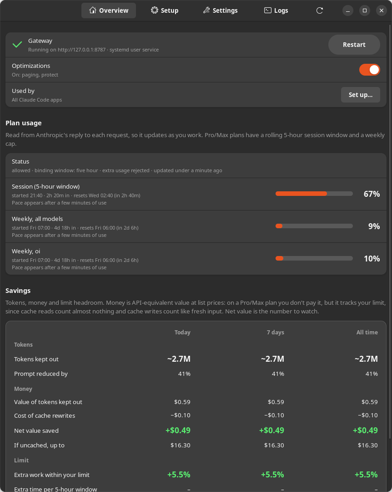
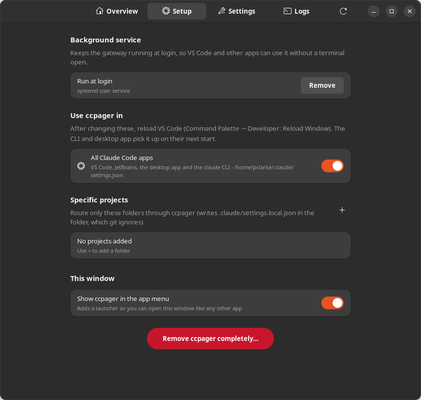
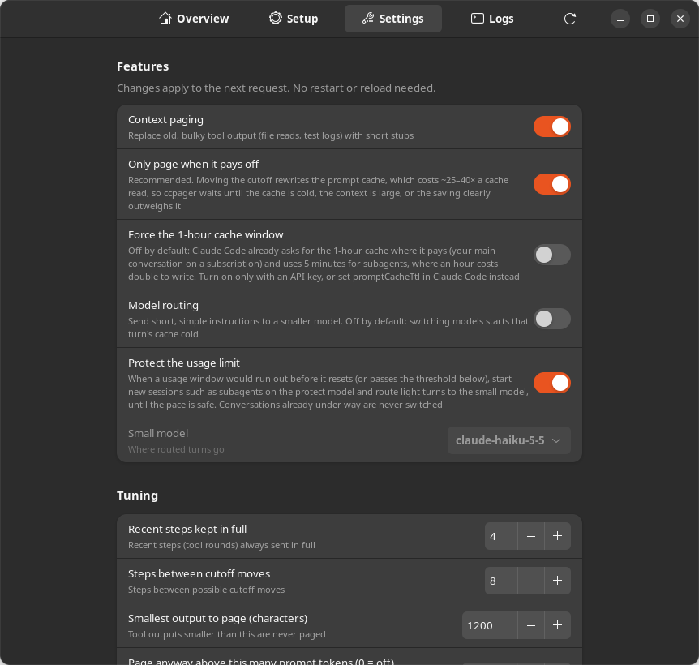
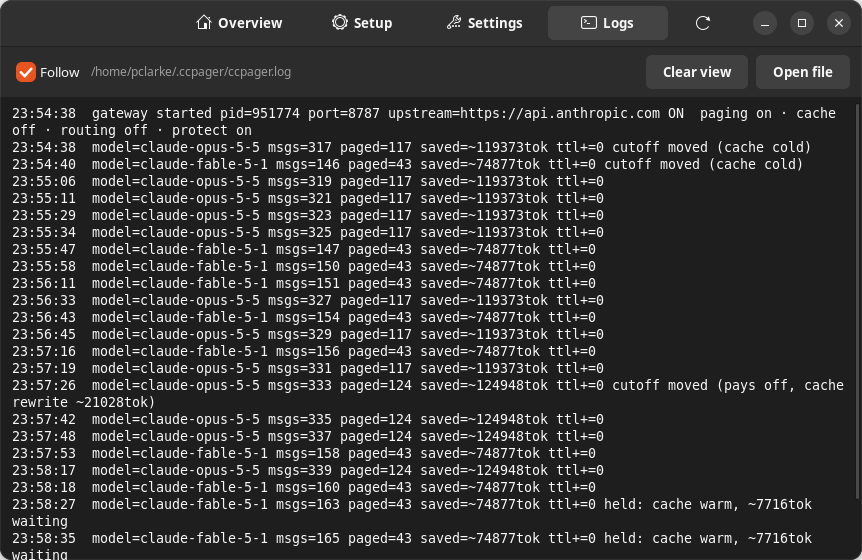

# ccpager

A local, open-source take on what Vachi AI does: a gateway that sits between Claude Code and Anthropic and trims each request before it counts against your plan. Zero dependencies, Node 18+, runs on 127.0.0.1, stores no prompts or responses.

## What it does

| Vachi feature | ccpager |
|---|---|
| Context paging (stale context removed) | Old tool results (file reads, test output, grep dumps) older than the last 6 tool steps are replaced with a one-line stub, but only when that's cheaper than leaving them (see below). Reads of a file that was read again later are paged as superseded. |
| Extended caching windows | Opt-in. Upgrades every `cache_control: ephemeral` breakpoint to `ttl: "1h"`. Off by default because Claude Code now requests the 1-hour cache itself where it pays (see "Cache TTL"). |
| Turn-level model routing (Vachi: "coming soon") | Opt-in. Short, clearly light instructions ("rename this variable") go to Haiku; anything mid-task or heavy stays on your model. |
| Usage insights | `ccpager stats`: tokens removed, net value after cache rewrites, cache hit rate. `ccpager usage`: your plan's 5-hour session and weekly limits, pace, and the predicted run-out time. |
| Adaptive protection | On by default. When a usage window would run out before it resets (or passes 80%), new sessions such as subagents start on Sonnet and light turns go to Haiku until the pace is safe. Conversations already under way are never switched (see "Protecting the limit"). |
| Zero data retention | No prompts or responses are stored. `~/.ccpager/stats.json` holds counters and the plan-usage percentages read from response headers; the log holds one line of counts per request. |

## Quick start on a Linux desktop

```bash
git clone https://github.com/peteclarke-del/ccpager.git && cd ccpager
./install.sh
```

That puts `ccpager` on your PATH, adds **ccpager** to your app menu and opens the settings window. Nothing is routed through ccpager until you switch it on: **Setup → All Claude Code apps** (or a specific project), then reload VS Code.

The window needs GTK 4 + libadwaita for Python, already present on most GNOME desktops. If the installer says it's missing:
`sudo apt install python3-gi gir1.2-gtk-4.0 gir1.2-adw-1` (Fedora: `sudo dnf install python3-gobject gtk4 libadwaita`, Arch: `sudo pacman -S python-gobject gtk4 libadwaita`).

| | |
|---|---|
|  |  |
|  |  |

- **Overview**: gateway status, the master on/off switch, where ccpager is in use, **plan usage** (5-hour session window and weekly cap as gauges, with time elapsed, reset time, current pace and the predicted run-out time, updating as you work), and a Savings card in three sections: tokens kept out, money (value of tokens kept out, cost of cache rewrites, the net, and the uncached ceiling) and limit (extra work that fits within your limit, and the extra time that buys per 5-hour window at your current pace), each for today, 7 days and all time. A red warning appears if Claude Code is pointed at ccpager while the gateway is down, with a one-click fix.
- **Setup**: run at login, route **all Claude Code apps** (VS Code, JetBrains, desktop app, CLI) or only **specific project folders**, add/remove the app-menu launcher, and remove everything.
- **Settings**: paging, 1-hour cache, model routing and limit-protection switches; the small model; tuning (steps kept, paging step, minimum size, large-context threshold, protection threshold); local port. Changes save immediately and apply to the next request; a port change restarts the gateway and updates Claude Code's settings for you. The protect model is set from the terminal (`ccpager set protectModel ...`).
- **Logs**: one line per request, following live.

The window runs the same `ccpager` commands you can type, so the window and the terminal always agree. Everything is saved in `~/.ccpager/state.json`.

## Install and run

```bash
cd ccpager
npm link                 # puts `ccpager` on your PATH (or use: node bin/ccpager.js …)

ccpager claude           # start gateway + launch Claude Code through it, one command
# or, two terminals:
ccpager start
ANTHROPIC_BASE_URL=http://127.0.0.1:8787 claude
# or permanently:
ccpager enable           # writes ANTHROPIC_BASE_URL to ~/.claude/settings.json
ccpager disable          # undo
```

Your existing login (Pro/Max OAuth or API key) passes straight through; ccpager never sees or stores it beyond forwarding the header.

## VS Code (and JetBrains, and the desktop app)

The Claude Code VS Code extension reads the same `~/.claude/settings.json` as the CLI, so it uses ccpager once that file points at it. The only catch is that the gateway must be running even when no terminal is open. One command handles both:

```bash
ccpager vscode
```

This:
1. installs the gateway to start at login (launchd on macOS, a systemd user service on Linux, a hidden Startup-folder script on Windows) and starts it now,
2. waits until it answers on 127.0.0.1:8787, and only then
3. writes `ANTHROPIC_BASE_URL` into `~/.claude/settings.json`.

Then reload VS Code (Command Palette → **Developer: Reload Window**). If the gateway fails to start, your settings are left alone, so Claude Code keeps working directly.

```bash
ccpager status      # is it running, and is Claude Code using it?
ccpager uninstall   # remove from startup, stop it, point Claude Code back at Anthropic
```

### Checking it's working

```bash
ccpager logs      # recent requests, then follows live. Send a message in VS Code and a line appears.
ccpager status    # gateway running? Claude Code pointed at it? what's switched on?
```

Each request logs one line ending with why it did or didn't page:

```
model=claude-opus-5-5 msgs=37 paged=0 saved=~0tok next cutoff in 1 steps
model=claude-opus-5-5 msgs=83 paged=8 saved=~17192tok held: cache warm, ~21028tok waiting
model=claude-opus-5-5 msgs=85 paged=29 saved=~56152tok cutoff moved (pays off, cache rewrite ~24750tok)
model=claude-sonnet-5-5 msgs=1 paged=0 saved=~0tok routed→claude-sonnet-5-5 (protect) next cutoff in 14 steps
```

The gateway writes this file itself (`~/.ccpager/ccpager.log`) on every OS. Paging can start after 14 tool steps (6 kept + 8). On a warm cache it often *holds* even then; see "When paging pays off".

`CCPAGER_*` settings present when you run `ccpager vscode` are baked into the service; re-run it after changing them. Re-running always replaces the running gateway.

## Turning it on and off

No restart, no VS Code reload. The change applies to the next request:

```bash
ccpager off            # pure pass-through: requests forwarded byte-for-byte unchanged
ccpager on             # back on
ccpager off routing    # or toggle one feature: paging | cache | routing | protect
ccpager on routing
```

The gateway stays in place while off (so Claude Code never loses its connection) and still logs and counts requests, which makes `off` useful for comparing usage with and without ccpager. Switches are saved in `~/.ccpager/state.json` and survive restarts. `ccpager uninstall` is the full removal.

## Plan usage: session window, weekly cap, run-out time

Anthropic answers every request with your plan's limit headers. ccpager reads them (no extra calls) and keeps a short history, so it can show the pace and when you'd run out:

```
$ ccpager usage
plan usage (from Anthropic's response headers, updated 2m ago)

  Session (5-hour window)    [███████░░░░░░░░░░░░░]  37%   started 14:02 (2h 10m in) · resets 19:02 (in 2h 50m)
                             at this pace (+12.0%/h): runs out 19:40, after the reset ✓
  Weekly, all models         [███░░░░░░░░░░░░░░░░░]  14%   started Thu 09:00 (3d 2h in) · resets Thu 09:00 (in 3d 22h)
                             pace +0.8%/h: won't run out before the reset ✓

  status allowed · binding window five_hour
```

The same appears on the window's Overview page as gauges that refresh every few seconds, and in one line of `ccpager status`. Pro/Max accounts report the rolling 5-hour session window, the weekly cap and sometimes per-model weekly caps; API keys report per-minute limits instead. The pace is a least-squares fit over the last 90 minutes (5-hour window) or 48 hours (weekly) of samples, so it reflects what you are actually doing right now; the prediction appears once there are a few minutes of samples.

## Protecting the limit

Pro/Max limits are hard stops when extra usage is off, so the most valuable moment to economise is the one when the pace says you'll hit the wall before the reset. With `protect` on (the default), the gateway checks the usage summary on every request and, while any plan window is predicted to run out before its reset, or is past `protectAt` percent (default 80), it:

- starts every **new** session (one with at most three messages and no paging state, which is what subagents, helpers and fresh conversations look like) on `protectModel` (default `claude-sonnet-5-5`) and keeps that session there for its whole life, so its cache is never invalidated by a model switch;
- turns on turn-level routing, so short, light instructions go to the small model.

Conversations already under way are left on their model: switching mid-conversation starts its cache cold, which costs more than it saves. Protection drops out on its own as soon as the pace is safe; sessions it started on Sonnet stay there. `ccpager status` shows `armed` or `ACTIVE` with the reason, the log records each change, and `ccpager stats --json` counts sessions started under protection (`protected`). `ccpager off protect` disables it; `ccpager set protectAt 90` or `ccpager set protectModel ...` tune it.

## Stats

```
$ ccpager stats
                                today         7 days       all time
  requests                       1812           2062           2062
  tokens kept out              ~14.9M         ~23.0M         ~23.0M
  prompt reduced by                8%            10%            10%
  value saved                   $3.06          $4.68          $4.68
    − cache rewrites            $8.13         $10.83         $10.83
  net value saved              −$5.07         −$6.15         −$6.15
    (if uncached)        up to $68.63     up to $101     up to $101
  API cost of the rest           $131           $158           $158
  extra work in limit           −3.9%          −3.9%          −3.9%
```

(That is a real two-day run of version 0.4 with the old defaults, included on purpose: see "When paging pays off" for why it was negative and what changed. A negative number means ccpager cost more than it saved over that period.)

- **Tokens kept out** is the sum, over every request, of the tokens removed from that request (a block paged at turn 10 counts again at turns 11, 12, … because it would have been resent each time). Estimated at ~4 characters per token.
- **Value saved** uses per-model API list prices. It's deliberately conservative: removed history would mostly have been a cache read, so that's how it's priced. **Cache rewrites** is the extra cost of moving the cutoff while the cache was warm. **Net** is the number to watch; `ccpager stats` warns when a week's net is negative.
- **If uncached** is the ceiling, reached when the cache would have expired anyway.
- **Extra work in limit** is net value as a share of what the requests cost: roughly how many more requests fit before a usage limit. The window also turns this into extra minutes per 5-hour session window at your current pace.
- **API cost of the rest** is what the requests that actually ran would cost in API credits, using the real usage numbers Anthropic returns, including 1-hour cache writes. A line shows what share of cache writes used the 1-hour and 5-minute tiers, which is how you confirm which TTL you're actually getting.
- On a Pro/Max plan you don't pay these amounts, but they are the best available guide to your usage limit. Anthropic says cached tokens count less than uncached ones against plan limits, and community measurements put a cache read at roughly 1/60th of a fresh token while cache writes count like fresh input. So **net value saved**, not the raw % of prompt tokens removed, is what tracks your limit: removing tokens that would have been cache reads saves almost nothing, and a cache rewrite costs real limit.

Prices are in `src/pricing.js` (from the Claude pricing page, Oct 2026); update them there if they change.

## When paging pays off

Removing old context changes the start of the prompt, so Anthropic rewrites the prompt cache from that point. On Opus 5.5 a cache write costs 25× (5-minute) to 40× (1-hour) a cache read. If your cache is warm (a 90%+ hit rate is normal for an active session), old context was only costing the cheap read rate, so moving the cutoff too often costs **more** than it saves, in dollars and in plan limit alike.

So by default (smart mode) the cutoff only moves when:
- **the cache is cold anyway**: a new or resumed session, after a compaction, or you've been away longer than the cache window, so the rewrite is free; or
- **it pays off**: the removed tokens, re-read over the expected remainder of the session, outweigh the one-off rewrite. The expected remainder is at least 30 requests and grows with the session (a session that has already run 80 steps is assumed to run 80 more, capped at 150), since long sessions tend to keep going.

When it does move, it moves as far as it can (everything older than the kept steps), because the rewrite costs the same however far it moves and a bigger move delays the next one; moves are then at least `pageStep` steps apart. Otherwise it holds the previous cutoff and the request is byte-identical to the last one, so the cache keeps hitting. The cache window used for "cold" is the one Anthropic actually applied to your session (read from each response), not an assumption.

Version 0.4 also forced a move whenever the context passed 150k tokens, to delay auto-compaction. On a real two-day run that was 40 of 49 moves and cost $10.83 of rewrites to save $4.68 (net −$6.15). It's now the opt-in `largeContext` setting, off by default: auto-compaction is cheap in tokens (one summary request on a warm cache), so paying for a rewrite every few steps to delay it only makes sense if you value keeping the raw history more than the limit.

Benchmark (simulated: a 200-step Opus 5.5 session with varied tool-output sizes, warm cache, billed with real caching rules and auto-compaction at 180k tokens, mean of 5 runs):

| mode | API cost (1h TTL) | API cost (5m TTL) | with a 70-min break every 40 steps | prompt tokens | compactions |
|---|---|---|---|---|---|
| off | $12.60 | $10.26 | $16.30 | 20.9M | 3.4 |
| **smart** (0.5 defaults: keep 6, step 8) | **$12.32 (−2%)** | **$9.99 (−3%)** | **$15.71 (−4%)** | 19.0M (−9%) | 0.2 |
| smart, keep 4 | $11.58 (−8%) | $9.58 (−7%) | $15.04 (−8%) | 17.1M | 0.2 |
| 0.4 rule (forced move above 150k) | $14.65 (+16%) | $11.23 (+9%) | $18.28 (+12%) | 17.9M | 0.0 |
| always | $15.30 (+21%) | $11.54 (+13%) | $19.14 (+17%) | 17.7M | 0.0 |

So expect a modest saving that grows with breaks and resumed sessions, and almost no auto-compactions. `keepTurns 4` saves more in this benchmark but the benchmark doesn't price the extra tool calls the model makes when it needs a file it read 5 steps ago, so 6 is the default; try 4 if your sessions are mostly long, linear investigations. The script is `test/bench.js`.

## Cache TTL

Claude Code decides the cache TTL itself: on a Claude subscription within plan usage the main conversation gets the 1-hour cache, subagents and helpers get 5 minutes, and everything gets 5 minutes on an API key or when the subscription is on usage credits. ccpager's "1-hour cache" switch forces `ttl: "1h"` onto every breakpoint, which doubles the write price for subagents that never idle, so it is **off by default**. If you use an API key and pause between turns, prefer Claude Code's own `promptCacheTtl: "1h"` setting (v2.1.242+), which upgrades only the main conversation; `ccpager on cache` is the blunt alternative. `ccpager stats` shows which tier your writes actually land on.

## How paging stays safe

- Only `tool_result` blocks inside user messages are rewritten. Assistant turns, thinking blocks and their signatures, and `tool_use` ids are never touched, so the API accepts the request.
- Decisions are frozen per session: a block stays stubbed once stubbed, and nothing older changes between cutoff moves (each Claude Code session and subagent is tracked separately).
- Stubs tell the model what was removed and to re-run the tool if it needs it ("Read src/auth/session.ts, 9812 chars, stale").
- Error results are kept. If a request body can't be parsed, it's forwarded unchanged (fail open).

## Tuning

Change these in the window (Settings → Tuning) or with `ccpager set NAME VALUE`; `ccpager get` lists them. Saved values apply live and win over the environment variables below, which are only defaults.

```bash
ccpager set keepTurns 6
ccpager set port 8800       # restarts the gateway and repoints Claude Code
ccpager enable --project ~/code/billing-api    # just one project
```

| Env var | Default | Meaning |
|---|---|---|
| `CCPAGER_KEEP_TURNS` | 6 | recent tool steps sent verbatim |
| `CCPAGER_PAGE_STEP` | 8 | minimum steps between cutoff moves |
| `CCPAGER_PAGING_MODE` | `smart` | `always` pages at every step boundary regardless of cache cost |
| `CCPAGER_MIN_CHARS` | 1200 | smaller tool outputs are never paged |
| `CCPAGER_LARGE_CONTEXT` | 0 | above this many prompt tokens, move even on a warm cache to delay auto-compaction (0 = off) |
| `CCPAGER_CACHE_TTL` | `off` | `1h` to force the 1-hour cache on every breakpoint |
| `CCPAGER_PROTECT` | `true` | adaptive protection of the usage limit (see above) |
| `CCPAGER_PROTECT_MODEL` | `claude-sonnet-5-5` | model new sessions start on while protection is active |
| `CCPAGER_PROTECT_AT` | 80 | percent of a window at which protection kicks in regardless of pace |
| `CCPAGER_ROUTING` | false | turn-level routing |
| `CCPAGER_SMALL_MODEL` | `claude-haiku-5-5` | routing target |
| `CCPAGER_PAGING` | true | master switch for paging |
| `CCPAGER_PORT` | 8787 | |
| `CCPAGER_VERBOSE` | false | echo each request line to the terminal as well as the log file |

## Honest caveats

- **Savings are modest on a warm cache** (a few percent; see the benchmark), because cache reads are nearly free both in dollars and against plan limits. The wins come from breaks, resumed sessions and avoided compactions. "2X" is Vachi's claim; measure your own with `ccpager stats`, which reports net savings after cache rewrites and warns when they go negative.
- **Forcing the 1h cache costs more** on short bursts (the write price is 2× base instead of 1.25×) and Claude Code already requests it where it pays, which is why it's off by default (see "Cache TTL").
- **Routing switches models**, and the cache is per-model, so a routed turn starts cold. That's why it's off by default.
- The model occasionally re-runs a tool to recover paged content. That's by design and usually far cheaper than resending it on every turn.
- Claude Code's own `/compact` and auto-compaction still apply; ccpager works alongside them.
- The biggest limit savings are on the Claude Code side, not in any proxy: set `CLAUDE_CODE_SUBAGENT_MODEL=claude-sonnet-5-5` in `~/.claude/settings.json` `env` so Explore and helper agents never run on Opus, keep tool output and replies terse (output tokens cost 5× input), and avoid spawning short-lived subagents for things a grep answers, since every fresh session rewrites the cache.
- Restarting the gateway (port change, update) stops accepting new connections at once but lets replies already streaming finish, for up to 30 seconds. Claude Code retries the connection in the meantime.
- If the upstream connection drops before any response (a reset keep-alive socket), the request is sent once more rather than failing the turn; the request body was buffered so nothing is lost.

## Tests

`npm test` runs unit tests for paging, TTL and routing, plan-limit parsing, run-out prediction and adaptive protection, plus end-to-end tests of the gateway against a mock Anthropic server (streaming, auth passthrough, usage and limit-header tracking, connection retry, protection kicking in). `node test/bench.js` runs the cost benchmark above.
